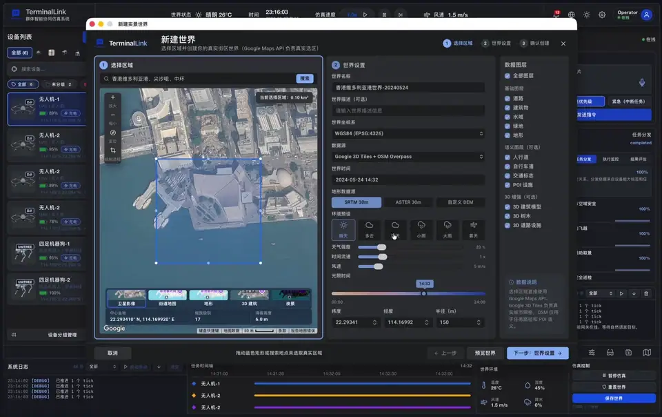
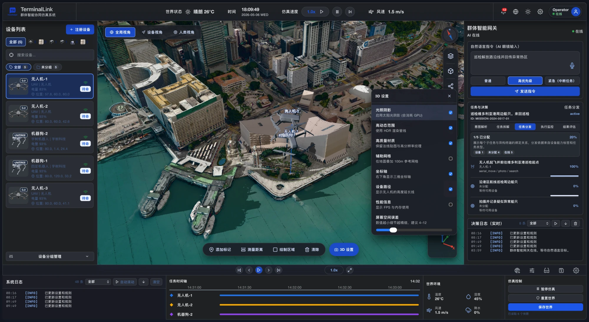
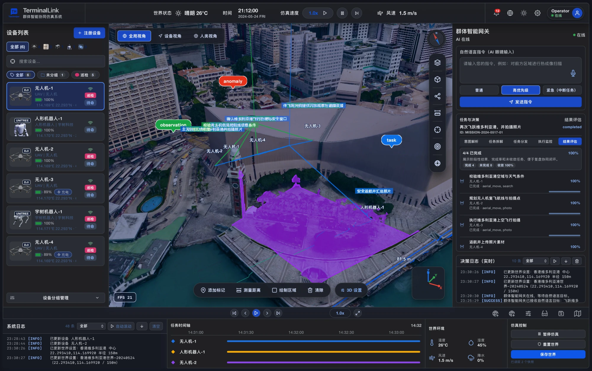

<div align="center">


# TerminalLink · 群体智能协同仿真系统

**World-Scale Cooperative Objective Simulator**

让无人机、人形机器人、四足机器狗、轮式机器人这些异构智能终端，<br/>
在真实尺度的 3D 城市里，围绕同一个自然语言目标协同解算与执行。

[](https://tauri.app)
[](https://www.rust-lang.org)
[](https://react.dev)
[](https://cesium.com/platform/cesiumjs/)
[](LICENSE)

[中文](#简介) · [English](#english)

</div>

<a href="docs/media/demo.mp4">
  
</a>

<p align="center"><sub>真实运行录屏的高光片段（加速 2–3 倍）· <a href="docs/media/demo.mp4"><b>▶ 观看完整演示视频（2 分 05 秒，带声音）</b></a></sub></p>

## 简介

现在的无人机、人形机器人、机器狗和轮式机器人单体能力都很强，但它们跑着各自的操作系统，感知能力有长有短，也没有被注册进同一个决策空间，所以很难真正协同。无人机蜂群早就有了以共同目标为解算尺度的群控算法，并且支持节点热插拔。TerminalLink 把这套思路推广到**异构**终端上：

1. **统一的人类输入网关**：人戴着 AI 智能眼镜说出（这里用输入框模拟 ASR）一个自然语言目标，比如「巡检解放路沿线并回传异常热区」。
2. **群体智能网关**：由大模型（或内置的规则型意图解析）理解意图，结合当前已注册终端各自的专长，拆解成若干子任务并分发；紧急目标可以打断正在执行的任务。
3. **终端节点自治**：每个终端只对网关下发的任务负责，自己解算移动、拍照、搜索等具体动作，并把实时反馈写回同一个决策域，网关据此持续修正整体规划，直到目标收敛。
4. **物理世界仿真**：所有协同都发生在真实尺度的城市里，并受「上帝规则」约束，比如无人机的最高和最低作业高度、机器狗和人形机器人能适应的最大坡度与地面材质、天气和风速。

更完整的设计见 [ProjectPRD.md](ProjectPRD.md) 和 [ARCHITECTURE.md](ARCHITECTURE.md)。

## 演示

[完整演示视频](docs/media/demo.mp4)（1600×1006，约 16 MB）按顺序演示了一次完整的协同流程：

| 时间 | 内容 |
| --- | --- |
| 0:00 | 新建世界：在卫星图上框选维多利亚港，配置坐标系、数据源、天气与光照，生成真实尺度世界 |
| 0:09 | 注册智能终端：选择无人机、人形机器人、四足机器狗等型号，配置能力标签、功耗、电池与初始位置 |
| 0:44 | 终端入场：设备出现在 3D 城市中，切换全局 / 设备 / 人类视角，调整 3D 设置与日夜光照 |
| 1:03 | 下发目标：以高优先级发送「飞跃维多利亚港，并拍摄照片」，网关拆解出 4 个子任务分发给各终端，场景里逐条出现任务链路标注 |
| 1:26 | 协同执行：绘制巡检 / 禁行 / 风险 / 扫描区域，标注观察点、异常与任务，终端沿航线协同执行，4/4 子任务收敛 |
| 1:40 | 编辑世界、近景巡视，最后切换到英文界面与浅色主题 |

## 截图

**任务分发 · 3D 场景设置**：左侧是热插拔注册的设备列表，右侧是群体智能网关，正在把「巡检维多利亚港周边船只」拆解并分发给终端。



**结果评估 · 任务链路可视化**：多台无人机与人形机器人协同完成「飞跃维多利亚港并拍摄照片」，4/4 子任务收敛；场景里叠加了观察、异常、任务标注、航线和绘制区域。



<sub>3D 城市数据来自 Google Photorealistic 3D Tiles，截图中的地图数据 © Google。</sub>

## 功能

- **真实尺度 3D 世界**：基于 CesiumJS 加载 Google Photorealistic 3D Tiles，可按经纬度和半径创建世界，自带瓦片磁盘缓存（LRU，默认上限 5 GiB）；天气、温湿度、风速、降水均可调。
- **异构终端热插拔**：支持无人机、人形机器人、四足机器狗、轮式机器人等类型，注册时可配置功耗、电池容量与作业规则，支持分组管理和巡检编组。设备模型来自 DJI Mavic 以及 Unitree G1 / Go2 的官方 URDF，并离线烘焙出步态和旋翼动画。
- **自然语言目标 → 协同任务**：群体智能网关完整展示意图解析、任务拆解、任务分发、执行监控、结果评估五个阶段，支持普通、高优先级和紧急（中断任务）三档优先级。
- **上帝级物理规则**：在控制面板里限制各类终端的作业高度、坡度、地面材质等约束，任务分配时生效。
- **多窗口工作台**：3D 世界主窗口、群体智能控制面板、AI 智能眼镜（含 GlassesMirror 反馈视图）、设备第一视角终端、任务详情、设置，都是独立的 Tauri 窗口，打开时会自动找屏幕上的空位。
- **场景工具**：全局、设备、人类三种视角，添加标记、测量距离、绘制巡检 / 禁行 / 风险 / 扫描区域，可切换光照阴影、HDR、设备路径、辅助网格和屏幕空间误差。
- **终端风格实时日志**：黑底等宽字体，按级别着色，支持筛选、自动滚动与清空；配合 D3 遥测图表和任务时间轴。
- **持久化**：应用状态和世界快照都以 TOML 保存在 Tauri 应用数据目录，可以随时保存或重新打开世界。
- **中英双语、深浅主题**。

## 架构

```text
┌────────────────────────────── Tauri 2 Desktop Shell ──────────────────────────────┐
│                                                                                   │
│  #/world        #/control         #/glasses        #/device/:id     #/settings    │
│  3D 世界主窗口   群体智能控制面板   AI 智能眼镜       设备第一视角       设置 ...       │
│  CesiumJS       规则 / 任务 / D3   ASR / Mirror     遥测 / 通信日志                  │
│       │               │                 │                 │                       │
│       └───────────────┴──── SimulationProvider (React Context) ───────────────────┤
│                                         │ invoke()                                │
│  ┌──────────────────────────────────────▼──────────────────────────────────────┐  │
│  │ Rust Simulation Core                                                        │  │
│  │ models · simulation（世界生成 / 任务拆解 / 步进 / 规则求解）                    │  │
│  │ llm（可选意图解析） · storage（TOML 持久化） · tile_cache（3D 瓦片缓存）          │  │
│  └─────────────────────────────────────────────────────────────────────────────┘  │
└───────────────────────────────────────────────────────────────────────────────────┘
```

| 层 | 技术 |
| --- | --- |
| 桌面壳 | Tauri 2（多窗口、地理定位插件） |
| 仿真核心 | Rust：tokio、reqwest、serde、toml |
| 前端 | React 19、TypeScript、Rsbuild、Tailwind CSS 4 |
| 3D | CesiumJS + Google Photorealistic 3D Tiles，three.js / urdf-loader 负责模型预览与烘焙 |
| 数据可视化 | D3 |
| 国际化 | i18next（`zh-CN` 默认，`en-US`） |

前端通过 [`src/api/invoke.ts`](src/api/invoke.ts) 调用 Rust 命令；在纯浏览器里运行时，[`src/api/browserFallback.ts`](src/api/browserFallback.ts) 会提供模拟实现，方便只调前端。

## 快速开始

### 环境要求

- Node.js 20+（开发时使用 24）
- Rust stable 工具链（开发时使用 1.93）
- 对应平台的 [Tauri 2 依赖](https://tauri.app/start/prerequisites/)
- 一个开通了 **Map Tiles API** 的 Google Maps API key，用于加载真实感 3D 城市

### 安装与运行

```bash
git clone https://github.com/spianmo/WorldScaleCooperativeSimulator.git
```

```bash
cd WorldScaleCooperativeSimulator && npm install
```

复制配置模板，然后填写你自己的密钥：

```bash
cp config/maps.example.toml config/maps.toml && cp config/llm.example.toml config/llm.toml
```

启动完整的桌面开发环境（首次会编译 Rust，需要几分钟）：

```bash
npm run tauri:dev
```

### 常用命令

| 命令 | 说明 |
| --- | --- |
| `npm run tauri:dev` | 桌面开发模式（Rust 编译 + 前端热更新） |
| `npm run tauri:build` | 打包生产版桌面应用 |
| `npm run dev` | 只启动前端，地址 `http://127.0.0.1:1420`（使用浏览器 fallback） |
| `npm run build` | 只构建前端 |
| `npm run typecheck` | TypeScript 类型检查 |
| `npm run bake:models` | 把 Unitree URDF 烘焙成 GLB 并注入步态动画 |
| `cd src-tauri && cargo check` | 只检查 Rust 后端 |

## 配置

两个配置文件都在 `.gitignore` 里，**不会被提交**。每个密钥都可以改用环境变量提供。

| 文件 | 用途 | 环境变量 |
| --- | --- | --- |
| `config/maps.toml` | `[google_maps].api_key`：Google Photorealistic 3D Tiles（必需）；`[cesium_ion].token`：Cesium ion 备用（可选） | `PUBLIC_GOOGLE_MAPS_API_KEY`、`PUBLIC_CESIUM_ION_TOKEN` |
| `config/llm.toml` | 可选的大模型意图解析，兼容 OpenAI Chat Completions 接口；默认 `enabled = false` | `OPENCLAUDECODE_API_KEY`（可通过 `api_key_env` 改名） |

不配置 LLM 时，网关会使用 Rust 内置的规则型意图解析：命中「巡检」「拍照」「搜索」等关键词时，生成对应的协同子任务。

> [!WARNING]
> 地图密钥会在构建时注入前端 bundle。如果要分发打包好的应用，请在 Google Cloud Console 里给这个 key 加上 API 范围和配额限制。

## 目录结构

```text
├── src/                  # React 前端
│   ├── api/              # Tauri invoke 封装与浏览器 fallback
│   ├── components/       # 3D 场景、日志、图表、场景工具条
│   ├── state/            # SimulationProvider、纯函数 store、跨窗口同步
│   ├── windows/          # 各独立窗口页面
│   ├── i18n/  styles/  types/  utils/
├── src-tauri/src/        # Rust 仿真核心（lib / models / simulation / llm / storage / tile_cache）
├── assets/
│   ├── models/           # DJI Mavic、Unitree G1 / Go2 模型与烘焙产物
│   ├── textures/         # Poly Haven / ambientCG CC0 材质
│   └── design/           # Logo 与设备缩略图
├── config/               # *.example.toml 配置模板
├── scripts/              # URDF → GLB 烘焙与动画注入脚本
└── docs/                 # README 截图与演示动画
```

## 第三方资源与致谢

| 资源 | 来源 | 许可证 |
| --- | --- | --- |
| DJI Mavic、Parrot Bebop 模型 | [thedylone/unity-drone-simulator](https://github.com/thedylone/unity-drone-simulator) | MIT，见 [`assets/models/UNITY_DRONE_SIMULATOR_LICENSE.txt`](assets/models/UNITY_DRONE_SIMULATOR_LICENSE.txt) |
| Unitree G1 / Go2 URDF 与网格 | [unitreerobotics/unitree_ros](https://github.com/unitreerobotics/unitree_ros)、[unitree_model](https://github.com/unitreerobotics/unitree_model) | BSD-3-Clause，见 [`assets/models/UNITREE_MODEL_LICENSE.txt`](assets/models/UNITREE_MODEL_LICENSE.txt) |
| 路面、立面、草地、混凝土材质 | [Poly Haven](https://polyhaven.com)、[ambientCG](https://ambientcg.com) | CC0 |
| 设备列表缩略图 | 各厂商产品页，详见 [`assets/design/README.md`](assets/design/README.md) | 版权归原厂商所有，仅作界面示意 |
| 3D 城市数据 | [Google Photorealistic 3D Tiles](https://developers.google.com/maps/documentation/tile/3d-tiles) | 受 Google Maps Platform 服务条款约束 |

各资源的详细来源记录在 [`assets/models/manifest.json`](assets/models/manifest.json) 和 [`assets/textures/manifest.json`](assets/textures/manifest.json)。DJI、Unitree、Autel、KEENON 等名称和商标归各自所有者，本项目与这些公司没有关联。

## 许可证

项目源代码以 [MIT License](LICENSE) 开源。`assets/` 下的第三方资源沿用各自原有的许可证，见上表。

---

<a id="english"></a>

## English

**TerminalLink** is a Tauri 2 desktop simulator for *world-scale cooperative objective solving*. Heterogeneous embodied terminals (drones, humanoids, quadrupeds, wheeled robots) are registered into one shared decision space and cooperate on a single natural-language goal inside a real-scale 3D city.

- A human wearing simulated **AI glasses** states a goal in natural language.
- The **swarm intelligence gateway** resolves the intent (via an optional LLM, or a built-in rule-based parser), decomposes it into sub-tasks matched to each registered device's capabilities, dispatches them, and keeps re-planning from live feedback until the goal converges. Urgent goals can pre-empt running tasks.
- Each device only owns the tasks it receives and solves its own motion and actions, all under configurable "god rules" such as drone altitude limits and the maximum slope or surface type each robot can handle.
- The world is rendered with **CesiumJS + Google Photorealistic 3D Tiles**, backed by a Rust simulation core with TOML persistence, a disk tile cache, multi-window UI, terminal-style live logs, D3 telemetry, and Chinese / English localisation.

A [full demo video](docs/media/demo.mp4) (2:05, with audio) walks through creating a world over Victoria Harbour, registering devices, sending the goal "fly over Victoria Harbour and take photos", and watching four sub-tasks converge.

### Quick start

You need Node.js 20+, a stable Rust toolchain, the [Tauri 2 prerequisites](https://tauri.app/start/prerequisites/), and a Google Maps API key with the Map Tiles API enabled.

```bash
git clone https://github.com/spianmo/WorldScaleCooperativeSimulator.git
```

```bash
cd WorldScaleCooperativeSimulator && npm install
```

```bash
cp config/maps.example.toml config/maps.toml && cp config/llm.example.toml config/llm.toml
```

```bash
npm run tauri:dev
```

Fill in `config/maps.toml` (required) and, optionally, `config/llm.toml`. Both files are git-ignored, and every key can also come from an environment variable (`PUBLIC_GOOGLE_MAPS_API_KEY`, `PUBLIC_CESIUM_ION_TOKEN`, `OPENCLAUDECODE_API_KEY`). Use `npm run dev` to run only the frontend in a browser with mocked backend commands.

### License

Source code is released under the [MIT License](LICENSE). Third-party assets under `assets/` keep their original licenses, listed in the table above.
